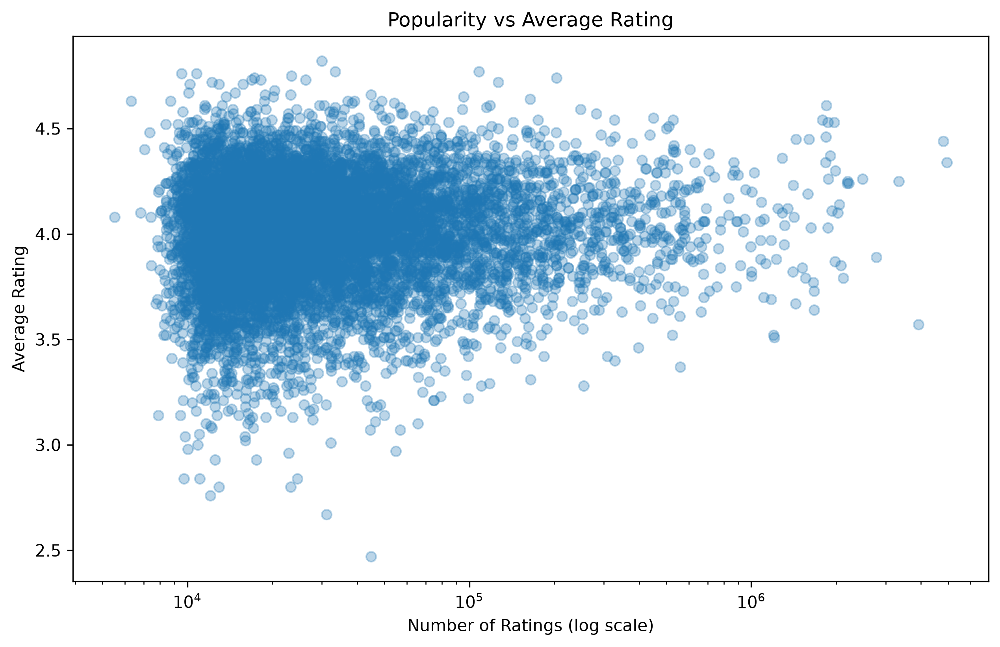
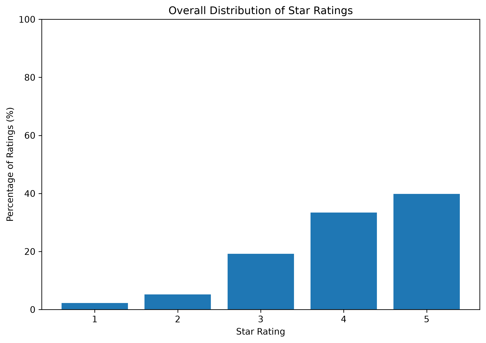
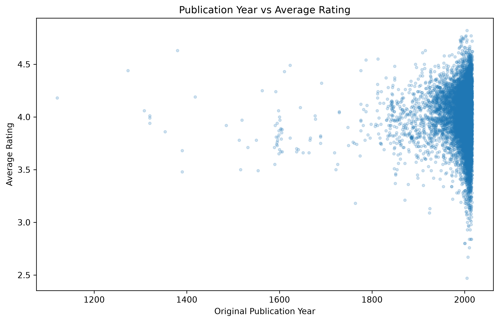
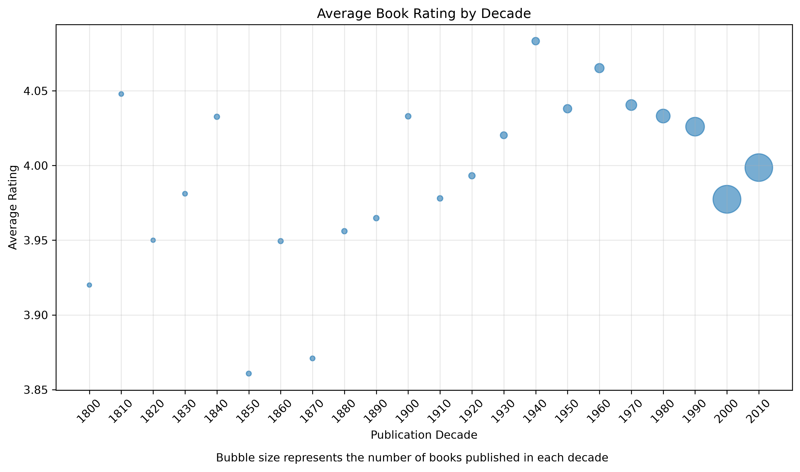
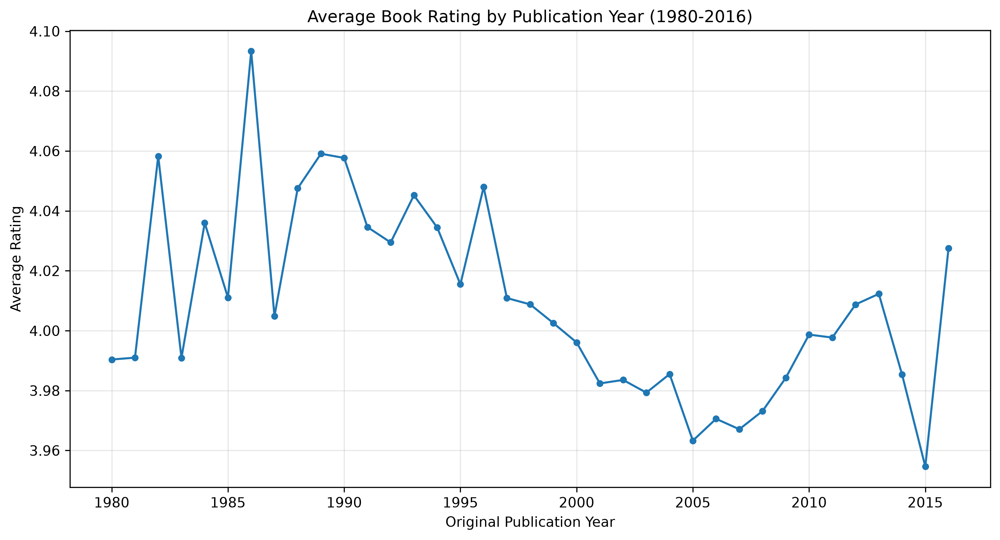

# Page Turners – Analysis Notes
## 1. Dataset exploration 
### 1.1 Books dataset (`books.csv`)

**Dataset dimensions**
- Rows: 10,000
- Columns: 23

**Relevant variables**
| Variable | Description |
|---|---|
| `book_id` | Dataset book identifier |
| `authors` | Book author(s) |
| `original_publication_year` | Original publication year |
| `title` | Book title |
| `average_rating` | Average book rating |
| `ratings_count` | Number of ratings |
| `work_ratings_count` | Number of ratings associated with the work |
| `ratings_1` – `ratings_5` | Number of ratings for each score |

**Missing values**
| Variable | Missing values |
|---|---:|
| `isbn` | 700 |
| `isbn13` | 585 |
| `original_title` | 585 |
| `original_publication_year` | 21 |
| `language_code` | 1,084 |
All other columns have no missing values.

### 1.2 Initial observations
- The dataset contains information about books, authors, publication years and reader ratings.
- `average_rating` can be used to investigate reader appreciation.
- `ratings_count` and `work_ratings_count` can help measure book popularity.
- Missing publication years will need to be considered before analyzing publication dates.

### 1.3 Ratings dataset (`ratings.csv`)

**Dataset dimensions**
- Rows: 5,976,479
- Columns: 3

**Variables**
| Variable | Description |
|---|---|
| `user_id` | Unique identifier of the user |
| `book_id` | Identifier of the rated book |
| `rating` | Rating assigned by the user (1–5) |

All three variables are stored as integers (`int64`).

**Descriptive statistics**
- Mean rating: 3.92
- Standard deviation: 0.99
- Minimum rating: 1
- Median rating: 4
- Maximum rating: 5

There are no missing values in this dataset.

**Initial observations**
- The dataset contains almost 6 million ratings.
- Ratings range from 1 to 5.
- The average rating is approximately 3.92, suggesting that ratings tend to be relatively positive.
- The dataset can be used to investigate user preferences and book popularity.

### 1.4 Book tags dataset (`book_tags.csv`)

**Dataset dimensions**
- Rows: 999,912
- Columns: 3

**Variables**
| Variable | Description |
|---|---|
| `goodreads_book_id` | Goodreads identifier of the book edition |
| `tag_id` | numerical identifier of the tag assigned to the book |
| `count` | Number of times users assigned the tag to the book |

All three variables are stored as integers (`int64`).

**Descriptive statistics**
- Mean count: 208.87
- Median count: 15
- Minimum count: -1
- Maximum count: 596,234

There are no missing values in this dataset.

**Initial observations**
- The dataset contains almost one million book-tag associations.
- `tag_id` contains numerical identifiers that need to be matched with `tags.csv` to identify the corresponding tag names.
- The mean count is considerably higher than the median, suggesting a highly uneven distribution.
- The minimum value of -1 will need further investigation during data cleaning.

### 1.5 Tags dataset (`tags.csv`)

**Dataset dimensions**
- Rows: 34,252
- Columns: 2

**Variables**
| Variable | Description |
|---|---|
| `tag_id` | Numerical identifier of the tag |
| `tag_name` | Textual name of the tag |

- `tag_id`: integer (`int64`)
- `tag_name`: string (`str`)

There are no missing values in this dataset.

**Initial observations**
- The dataset contains 34,252 different tag identifiers and their corresponding names.
- `tags.csv` can be used to translate the numerical `tag_id` values in `book_tags.csv` into readable labels.

### 1.6 To-read dataset (`to_read.csv`)

**Dataset dimensions**
- Rows: 912,705
- Columns: 2

**Variables**
| Variable | Description |
|---|---|
| `user_id` | Identifier of the user |
| `book_id` | Identifier of the work marked as "to read", corresponding to `work_id` in `books.csv` |

Both variables are stored as integers (`int64`).

There are no missing values in this dataset.

**Initial observations**
- The dataset contains 912,705 user-book associations.
- Each row represents a book marked as "to read" by a user.
- The dataset can be used to investigate users' reading interests and preferences.

## 2. Initial dataset relationships

### 2.1 Relationship between books and ratings

The relationship between `books.csv` and `ratings.csv` was checked using the `book_id` variable.

- Unique book IDs in `ratings.csv`: 10,000
- Unique book IDs in `books.csv`: 10,000
- All book IDs in `ratings.csv` are present in `books.csv`.

The check returned `True`, confirming that all rating records can be associated with a book in the books dataset using `book_id`.

This is a one-to-many relationship: each book can have multiple ratings from different users, while each rating record refers to one book.

### 2.2 Relationship between books and to_read

The relationship between `books.csv` and `to_read.csv` was checked using the `book_id` variable.

- Unique book IDs in `to_read.csv`: 9,986
- Unique book IDs in `books.csv`: 10,000
- All book IDs in `to_read.csv` are present in `books.csv`.

The check returned `True`, confirming that all to-read records can be associated with a book in the books dataset using `book_id`.

However, 14 books in `books.csv` do not appear in `to_read.csv`.

### 2.3 Relationship between books and book_tags

The relationship between `books.csv` and `book_tags.csv` was checked using the `goodreads_book_id` variable.

- Unique Goodreads book IDs in `book_tags.csv`: 10,000
- All Goodreads book IDs in `book_tags.csv` are present in `books.csv`.

The check returned `True`, confirming that all tag records can be associated with a book in the books dataset using `goodreads_book_id`.

This is a one-to-many relationship: each book can have multiple associated tags.

### 2.4 Relationship between book_tags and tags

The relationship between `book_tags.csv` and `tags.csv` was checked using the `tag_id` variable.

- Unique tag IDs in `book_tags.csv`: 34,252
- Unique tag IDs in `tags.csv`: 34,252
- All tag IDs in `book_tags.csv` are present in `tags.csv`.

The check returned `True`, confirming that all tag records can be associated with their corresponding tag names using `tag_id`.

This allows us to identify the tags assigned to each book and potentially use them to investigate differences in average ratings across genres.

## 3. Duplicate records analysis

### 3.1 Books
No fully duplicated rows or duplicated `book_id` values were found.
Each book has a unique identifier.

### 3.2 Ratings
No fully duplicated rows or duplicated combinations of `user_id` and `book_id` were found.
Each user-book combination appears at most once.

### 3.3 To-read
No fully duplicated rows or duplicated combinations of `user_id` and `book_id` were found.

### 3.4 Book tags
The initial analysis identified:
- 6 fully duplicated rows.
- 8 duplicated book-tag combinations.

The 6 fully duplicated rows were removed using `drop_duplicates()`.
The remaining 2 duplicated combinations have conflicting `count` values and were temporarily retained because the correct values could not be determined.
The cleaned dataset contains 999,906 rows.

### 3.5 Tags
No fully duplicated rows, duplicated `tag_id` values or duplicated `tag_name` values were found.
Each tag has a unique identifier and name.

## 4. Data Cleaning and Anomaly Checks

### 4.1 Missing Publication Years

- `books.csv` contains **21 missing values** in `original_publication_year`.
- A separate DataFrame, `books_with_year`, was created using `dropna(subset=["original_publication_year"])`.
- The resulting DataFrame contains **9,979 books**.
- The original `books` DataFrame was preserved for analyses not involving publication year.
- Missing ISBNs, original titles, and language codes were retained because they are not essential to the main research questions.

### 4.2 Publication Year Validation

- Publication years range from **-1750 to 2017**.
- **125 books** have publication years earlier than 1800.
- These records were retained because they largely correspond to historical and classical works.
- Publication years for ancient works may be approximate.

### 4.3 Rating and Popularity Validation

- `average_rating` ranges from **2.47 to 4.82**, with no values outside the valid 1–5 interval.
- `ratings_count` ranges from **2,716 to 4,780,653**, with no zero or negative values.
- No negative values were found in `ratings_1`, `ratings_2`, `ratings_3`, `ratings_4`, or `ratings_5`.
- No corrections were required for these variables.

### 4.4 Negative Tag Counts

- **6 records** in `book_tags` contained `count = -1`.
- The affected records belonged to **2 books**.
- The negative counts were associated with the tags `ebook`, `no-audio`, `kindle-library`, `challenge-2013`, `america-in-retreat`, and `default`.
- These records were removed because tag frequencies cannot be negative.
- After removing **6 exact duplicates** and **6 negative-count records**, `book_tags_clean` contains **999,900 rows**.
- Two book-tag pairs with conflicting positive counts were retained because the correct values could not be determined.

### 4.5 Rating Count Consistency

- The sum of `ratings_1` through `ratings_5` was calculated for each book and stored in `total_star_ratings`.
- This sum differed from `ratings_count` for **9,986 books**.
- However, it matched `work_ratings_count` for **all 10,000 books**.
- This confirms that the star-rating distributions correspond to **work-level ratings** rather than edition-level ratings.
- No corrections were required.

### 4.6 Final Cleaning Decisions

- Original datasets were preserved whenever possible.
- Missing publication years were excluded **only from year-based analyses**.
- Exact duplicates and invalid negative tag counts were removed.
- Valid historical publication years were retained.
- The cleaned `book_tags_clean` DataFrame contains **999,900 records**.
- `work_ratings_count` will be used as the **primary popularity measure** in the first research question.

**Conclusion:** The datasets have been checked for missing values, duplicates, invalid numerical values, and rating-count consistency. The data is now ready for exploratory and statistical analysis.

## RQ1 — Popularity & ratings

**Research question:** Is there a relationship between the number of ratings a book receives and its average rating?

### Data and methods
The analysis uses two variables from `books.csv`:
- `work_ratings_count`: the total number of ratings received by each book, used as a measure of popularity.
- `average_rating`: the average rating of each book, used as a measure of appreciation.

The analysis includes:
- Descriptive statistics using `describe()` to summarize the two variables.
- Pearson correlation to measure the linear association between popularity and ratings.
- Spearman correlation to measure the monotonic association between the two variables.
- A scatter plot with a logarithmic x-axis to visualize the relationship.

The logarithmic scale makes it easier to visualize books with very different numbers of ratings.

### Results
The analysis produces the following correlation coefficients:
- **Pearson correlation: 0.045**
- **Spearman correlation: 0.065**

Both coefficients are close to zero, indicating a negligible association between the number of ratings and average rating.
The scatter plot does not reveal a clear increasing or decreasing trend.

### Visualization

The scatter plot represents each book using:
- **X-axis:** number of ratings received (`work_ratings_count`), displayed on a logarithmic scale.
- **Y-axis:** average rating (`average_rating`).

The visualization shows that books with different levels of popularity can have similar average ratings.

### Conclusion
Both Pearson and Spearman correlations indicate a negligible association between popularity and appreciation.
Therefore, books receiving more ratings do not necessarily achieve higher average ratings.

## RQ2 — Rating distributions

**Research question:** How do readers' rating distributions differ across books?

### Data preparation and validation

The analysis uses five variables from `books.csv`:
- `ratings_1`: number of 1-star ratings.
- `ratings_2`: number of 2-star ratings.
- `ratings_3`: number of 3-star ratings.
- `ratings_4`: number of 4-star ratings.
- `ratings_5`: number of 5-star ratings.

Before calculating the rating distributions, the script performs the following checks:
- Checks for missing values in the five rating columns.
- Calculates the total number of ratings for each book by summing the five rating counts.
- Checks whether any books have zero total ratings.
- Verifies that the calculated totals match `work_ratings_count`.
- Calculates the percentage of ratings for each star value and each book.
- Verifies that the five percentages sum to 100% for each book.

### Methods
The analysis examines both individual book rating distributions and the overall rating distribution.

**1. Individual book rating distribution**
For each book, the percentage of ratings for each star value (1 to 5) is calculated by dividing the corresponding rating count by the total number of ratings received by that book.

**Percentage = (Ratings for a specific star value / Total ratings for the book) × 100**

**2. Overall rating distribution**
The overall distribution is calculated by summing the rating counts for each star value across all books.
Each sum is then divided by the total number of ratings in the dataset and multiplied by 100.
This approach calculates the overall distribution using all ratings rather than averaging the percentages of individual books.

### Results
| Rating | Percentage |
|---|---:|
| 1 star | 2.25% |
| 2 stars | 5.21% |
| 3 stars | 19.23% |
| 4 stars | 33.45% |
| 5 stars | 39.86% |

Overall, **73.31% of ratings are 4 or 5 stars**, indicating that positive evaluations dominate the dataset.
However, rating distributions can differ across individual books.

### Visualizations

#### 1. Overall rating distribution

A static Matplotlib bar chart illustrates the overall percentage of ratings from 1 to 5 stars.
The chart shows that 4-star and 5-star ratings account for the largest shares of evaluations.

#### 2. Individual book rating distribution
An interactive Plotly bar chart illustrates the rating distribution of an individual book.

The Python script uses the first book in the dataset as an example and displays the percentage of ratings for each star value.

The Streamlit dashboard extends this visualization by allowing users to select different books.

### Interactive streamlit dashboard
The Streamlit dashboard allows users to select a book by title or author and explore its rating distribution.

For each selected book:
- The percentage of ratings from 1 to 5 stars is calculated.
- A Plotly bar chart displays the five percentages.
- The book's average rating is shown separately.

This visualization helps identify differences between books that may not be immediately apparent from their average ratings alone.

### Data export
A reduced dataset containing only the variables required by the Streamlit dashboard is exported to `data/books_for_app.csv`.

This reduces unnecessary data loading and simplifies the application, while preserving all the information needed for the three research questions.

### Conclusion
Positive evaluations dominate the dataset, with **73.31% of ratings receiving 4 or 5 stars**.

However, rating distributions can vary across books, demonstrating that average ratings alone do not fully describe readers' evaluations.

## RQ3 — Publication year

**Research question:** Does a book's original publication year influence its average rating?

### Data preparation
The analysis uses two variables from `books.csv`:
- `original_publication_year`: the year in which the book was originally published.
- `average_rating`: the average Goodreads rating of the book.

The original dataset contains **10,000 books**, of which **21 have missing publication years**.
After excluding these observations, **9,979 books** remain available for analysis.

All available publication years are included in the correlation analysis, while different time ranges are selected for the visualizations to improve readability.

### Statistical analysis
The analysis calculates two correlation coefficients:
- **Pearson correlation: 0.016**
- **Spearman correlation: -0.027**

Both coefficients are close to zero, indicating a negligible overall linear and monotonic association between publication year and average rating.

### Visualizations

#### 1. Publication year vs average rating

A scatter plot illustrates the relationship between original publication year and average rating.
Each point represents a book. The visualization includes only books published from the year 1000 onward to improve readability.
The scatter plot does not reveal a clear increasing or decreasing trend.

#### 2. Average rating by decade

Books published from 1800 onward are grouped by decade.
For each decade, the analysis calculates:
- The mean of the books' average ratings.
- The number of books included in that decade.

The bubble chart displays the average rating for each decade, with bubble size representing the number of books.
Average ratings remain relatively stable, generally around 4 stars. Earlier decades contain fewer books, so their averages should be interpreted with caution.

#### 3. Average rating by publication year (1980–2016)

A line chart illustrates the average rating for each publication year between 1980 and 2016.
For each year, the analysis calculates the mean of the books' average ratings and the number of books.

The year 2017 is excluded from this visualization because it contains only 11 books, although it remains included in the correlation analysis.

Some fluctuations are visible, but no consistent increasing or decreasing trend emerges.

### Interactive streamlit dashboard
The Streamlit dashboard provides an interactive Plotly line chart to explore average ratings across publication years.

Users can:
- Select a publication-year interval using a slider.
- Group the data by individual year or decade.
- Explore average ratings over time.
- View the number of books included in each period.

For each selected year or decade, the dashboard calculates the mean of the books' average ratings and the number of books.

Pearson and Spearman correlations are dynamically calculated using the books within the selected publication period.
These coefficients update when the user changes the interval, allowing the relationship between publication year and average rating to be explored across different time ranges.
The overall correlations reported in the statistical analysis section refer to all books with available publication years.

### Key findings
- Publication year has a negligible overall correlation with average rating.
- Average ratings remain relatively stable across decades.
- Annual fluctuations exist, but no consistent temporal trend emerges.
- The number of books varies across publication periods, affecting the interpretation of group averages.

### Limitations
The Goodbooks-10k dataset is not representative of all published books.

Furthermore, the analysis uses book-level average ratings rather than individual reader ratings. Each book contributes equally to the yearly and decadal averages, regardless of how many ratings it receives.

### Conclusion
The analysis does not reveal a strong overall association between a book's original publication year and its average Goodreads rating.

Older books are not systematically rated higher or lower than more recently published books in this dataset.